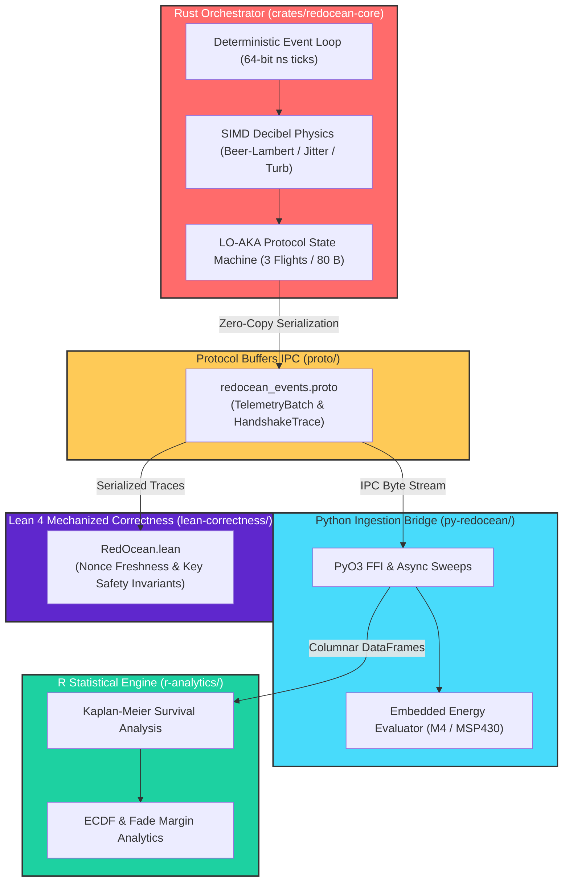

# 🌊 RedOcean

### High-Performance Channel-Aware Simulation and Formal Verification Engine for Underwater Optical Wireless Networks

`[Status: Building]` 🟡 `[Architecture: Multi-Binary Monorepo]` ⚙️ `[Primitive: ASCON-128a]` 🔐 `[Verification: Lean 4 Mechanized]` 📐 `[License: MIT]` 📜

---

## 🎯 Overview

**RedOcean** (**R**eliable **D**ecibel-scale **O**ptical **C**ommunication and **E**xecution **A**uthentication **N**etwork) is a deterministic simulation and runtime verification engine designed for high-rate, energy-constrained Underwater Optical Wireless Communication (UOWC) networks.

Underwater optical links experience steep physical decibel-scale path losses driven by seawater extinction, beam divergence, pointing jitter, and oceanic turbulence. Terrestrial protocol handshakes (>1.2 KB) suffer catastrophic packet error rates under these channel conditions. RedOcean provides an end-to-end framework combining:
- **LO-AKA State Machine:** Ultra-compact 3-flight, 80-byte mutual authentication and key agreement engine built on NIST ASCON-128a.
- **SIMD Decibel Physics:** Closed-form decibel-scale channel loss formulations across Jerlov seawater classifications (Pure Sea, Clear Ocean, Coastal Ocean, Turbid Harbor).
- **Polyglot Verification Engine:** Coordinated Rust orchestrator, Protocol Buffers boundary contracts, Python telemetry ingestion, R analytics, and on-the-fly Lean 4 mechanized theorem proving.

---

## ⚡ Quickstart

```bash
# 1. Quick sanity smoke test (< 15 seconds)
make smoke

# 2. Run full test suite & proof verification (< 1 minute)
make verify

# 3. Compile Protocol Buffers boundary schemas
make proto
```

---

## 🏗️ Polyglot Architecture

RedOcean enforces strict root-level domain decoupling following **Design Dungeons** canonical systems layouts:



---

## 📦 Component Inventory

| Directory | Domain Role | Tech Stack | Notes |
| :--- | :--- | :--- | :--- |
| **`crates/redocean-core/`** | Discrete-event engine, SIMD decibel channel physics, protocol state machine | Rust (2021 edition) | Core simulator binary `redocean-sim` |
| **`proto/`** | Language-neutral zero-copy IPC boundary contracts | Protocol Buffers (proto3) | Schema: `redocean_events.proto` |
| **`py-redocean/`** | Parametric sweep harness and embedded energy profiling | Python 3.10+ (NumPy / SciPy) | Telemetry ingestion & energy models |
| **`r-analytics/`** | Empirical survival modeling and statistical distributions | R (v4.2+) | Nonparametric fade modeling |
| **`lean-correctness/`** | Mechanized interactive theorem proving for runtime trace safety | Lean 4 (v4.35.0) | Proves safety & freshness invariants |
| **`results/canonical/`** | Pre-registered deterministic JSON manifests and seed logs | JSON / SHA-256 | ChaosSeal reproducibility discipline |
| **`docs/adrs/`** | Architecture Decision Records (ADR-001 through ADR-005) | Markdown | Architecture rationale |

---

## 🧭 System Verification & Navigation

For technical walkthroughs and verification paths:

- **[`REVIEWER_GUIDE.md`](./REVIEWER_GUIDE.md):** 15-min, 30-min, and 2-hr verification pathways.
- **[`CLAIM_MAP.md`](./CLAIM_MAP.md):** Architectural guarantee mapping from specs to generating code.
- **[`VERIFY.md`](./VERIFY.md):** Fast hash-verified verification pathway.
- **[`REPRODUCE.md`](./REPRODUCE.md):** Full pipeline reproduction instructions.
- **[`LIMITATIONS.md`](./LIMITATIONS.md):** Physical and mathematical boundary conditions.
- **[`REPRODUCIBILITY_LEVELS.md`](./REPRODUCIBILITY_LEVELS.md):** R1–R4 classification across all benchmarks.

---

## 📜 Architecture Decision Records (ADRs)

Key architectural decisions are documented in [`docs/adrs/`](./docs/adrs/):
- **[ADR-001](./docs/adrs/0001-record-architecture-decisions.md):** Record Architecture Decisions
- **[ADR-002](./docs/adrs/0002-polyglot-simulation-stack.md):** Polyglot Simulation and Verification Architecture
- **[ADR-003](./docs/adrs/0003-channel-loss-in-decibels.md):** Closed-Form Optical Channel Loss Formulations in Decibels
- **[ADR-004](./docs/adrs/0004-lightweight-ascon-sponge.md):** Adopting NIST ASCON-128a Sponge Primitive for LO-AKA
- **[ADR-005](./docs/adrs/0005-mechanized-trace-correctness.md):** On-The-Fly Mechanized Trace Correctness with Lean 4

---

## 📄 License

This project is licensed under the terms of the [MIT License](./LICENSE).
